<!-- Every image here is made by scripts/build.mjs. Stats, cards and the snake refresh daily (.github/workflows/refresh.yml). -->

  

  <a href="https://www.linkedin.com/in/yashx420"></a>
  <a href="https://www.instagram.com/askbro.io"></a>

  

  

  <a href="https://play.google.com/store/apps/details?id=gift.aurea.app"></a>
  <a href="https://onelink.to/askbro"></a>

  <b>Auréa</b>: <a href="https://play.google.com/store/apps/details?id=gift.aurea.app">get it on android</a> ↗ &nbsp;·&nbsp; <a href="https://aureagifts.com">aureagifts.com</a> ↗
  &nbsp;&nbsp;✦&nbsp;&nbsp;
  <b>Bro</b>: <a href="https://onelink.to/askbro">get the app</a> ↗ &nbsp;·&nbsp; <a href="https://askbro.io">askbro.io</a> ↗

  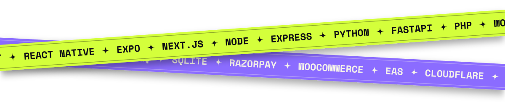

  

  <a href="https://github.com/yashx420/palmbeat">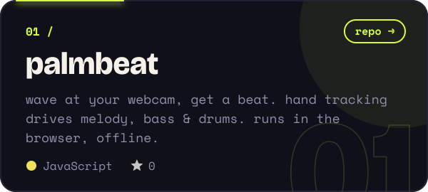</a>
  <a href="https://github.com/yashx420/Sentinel">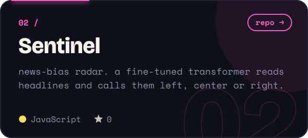</a>
  <a href="https://github.com/yashx420/lead-engine">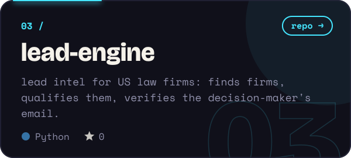</a>
  <a href="https://github.com/yashx420/solace-ai">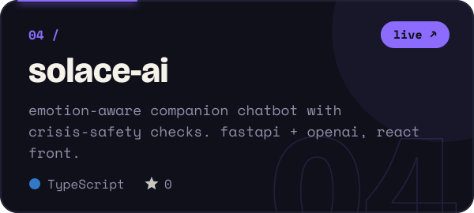</a>
  <a href="https://github.com/yashx420/reachinbox-email-scheduler">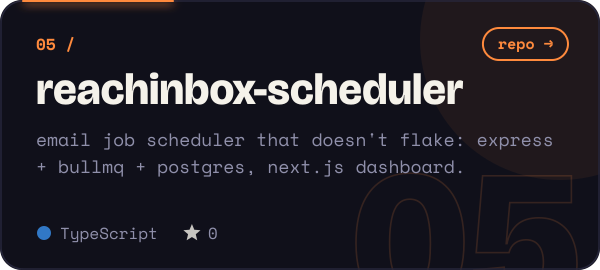</a>
  <a href="https://github.com/yashx420/Universe">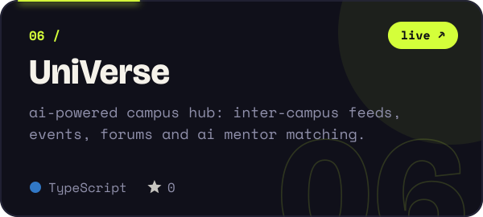</a>

  

  <a href="https://aureagifts.com"><b>Auréa</b></a> ↗ &nbsp;·&nbsp;
  <a href="https://aizen-eight.vercel.app">Aizen</a> ↗ &nbsp;·&nbsp;
  <a href="https://kevnit-digital.vercel.app">Kevnit</a> ↗ &nbsp;·&nbsp;
  <a href="https://scalestone.vercel.app">Scalestone</a> ↗ &nbsp;·&nbsp;
  <a href="https://hidden-wealth.vercel.app">Hidden Wealth</a> ↗ &nbsp;·&nbsp;
  <a href="https://orbit-pi-fawn.vercel.app">Orbit Hospitality</a> ↗
   
  <a href="https://sklovera.vercel.app">Sklovera</a> ↗ &nbsp;·&nbsp;
  <a href="https://nvvfoundation.vercel.app">NVV Foundation</a> ↗ &nbsp;·&nbsp;
  <a href="https://wonder-mega-city.vercel.app">Wonder Mega City</a> ↗ &nbsp;·&nbsp;
  <a href="https://meridian-delta-five.vercel.app">Meridian</a> ↗ &nbsp;·&nbsp;
  <a href="https://universe-alpha-one.vercel.app">UniVerse</a> ↗ &nbsp;·&nbsp;
  <a href="https://gamezilla.vercel.app">Gamezilla</a> ↗

  

  

  <picture>
    <source media="(prefers-color-scheme: dark)" srcset="https://raw.githubusercontent.com/yashx420/yashx420/output/snake-dark.svg" />
    <source media="(prefers-color-scheme: light)" srcset="https://raw.githubusercontent.com/yashx420/yashx420/output/snake-light.svg" />
    
  </picture>

  

